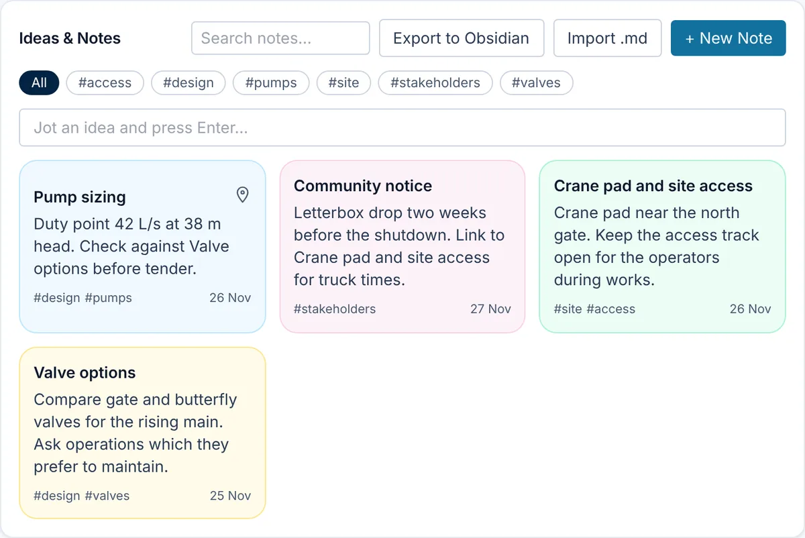
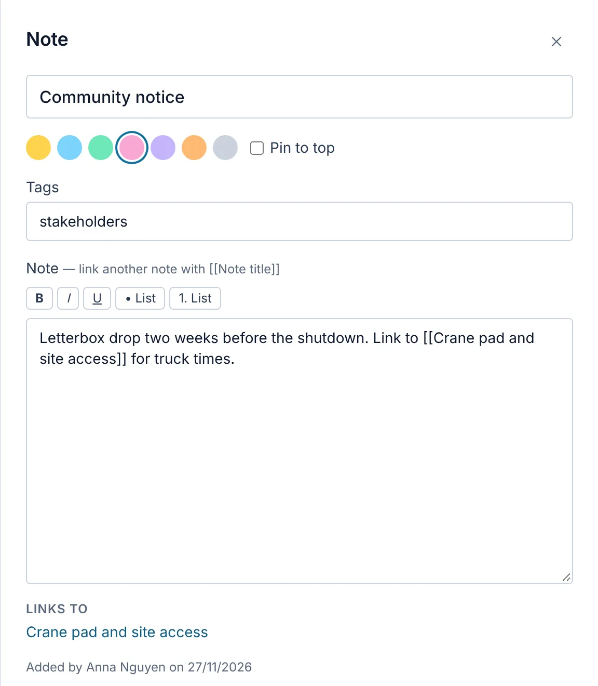
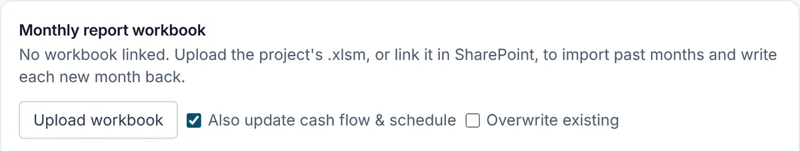
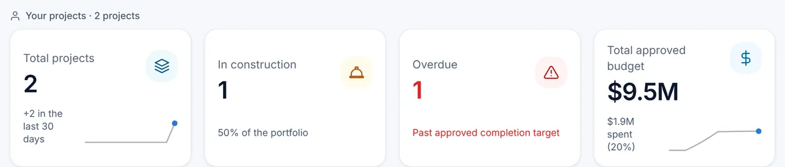
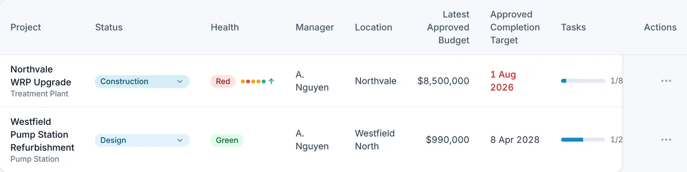

<!-- version: 3.1.1 -->
# What's new in the dashboard

**Somewhere to brainstorm on every project, less retyping from your monthly report, and clearer budget and date labels.**

## Ideas & Notes on every project

Open a project and scroll down the **Overview** tab to **Ideas & Notes**. It's a board for options, loose thoughts and things to follow up.

- Type in **Jot an idea and press Enter…** to add a note in a second, or use **+ New Note** for more detail.
- Give notes a colour and tags, pin the important ones to the top, and click a tag to see only those notes.
- Link one note to another by typing its title in double square brackets, like `[[Valve options]]`. Each note lists the notes it links to and the notes that link to it.
- **Export to Obsidian** downloads all of the project's notes, ready to drop into an Obsidian vault. **Import .md** brings Markdown notes back in.

## Fill in a project from its monthly report

On a project's **Monthly Reporting** tab, tick **Also update cash flow & schedule** before you upload the workbook or pull it from SharePoint.

- The project's monthly cash flow (actuals up to the report month, forecasts after), its milestones and its approved completion date are copied in for you.
- Only empty values are filled in. Tick **Overwrite existing** as well if you want the workbook's figures to replace what's already in the dashboard.

## Dashboard tiles match your filter

Choose **My projects** or a project manager, and the tiles at the top count only those projects. The line above them says whose projects you're looking at.

## Clearer budget and date labels

- **Target Completion** is now called **Approved Completion Target** everywhere.
- The dashboard's budget column is now **Latest Approved Budget**, so it includes approved changes. Hover over a figure to see the original budget.

## Smaller things

- **Spell check** in every text box, in Australian English.
- The bold, italic and list buttons stay at the top while you scroll through long text, such as meeting minutes.
- You can open this page again any time: click your initials in the top right, then **What's new**.
